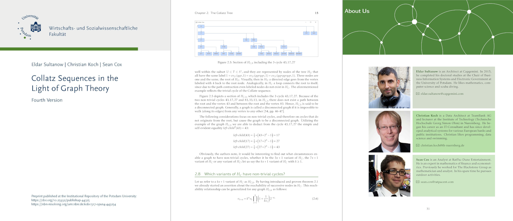

# 01 Graph Theory

[](https://doi.org/10.25932/publishup-48214) [](https://doi.org/10.25932/publishup-48214) [](https://creativecommons.org/licenses/by/4.0/)

> **Paper:** E. Sultanow, C. Koch, S. Cox, *Collatz Sequences in the Light of Graph Theory* (Fifth Version). University of Potsdam (2020), [doi:10.25932/publishup-48214](https://doi.org/10.25932/publishup-48214). **Read it on [publish.UP](https://doi.org/10.25932/publishup-48214).** This folder contains the TeX sources of all versions kept in the repository and the code of the graph-theoretical investigations.

This is where the whole project started: a continuously evolving manuscript, published by the University of Potsdam as an open book to which everyone is invited to contribute.

Inverting the Collatz map turns its orbits into a tree with root 1, and the conjecture says that this tree contains every positive integer. The manuscript builds this tree with the tools of algebraic graph theory (Cayley graphs, free groups), reduces it to the nodes with odd labels and studies reachability and cycles, both for $3x+1$ and for the generalization $kx+1$. Starting with the fifth version, the Collatz graph is transformed into a binary tree following Kleinnijenhuis.

## Paper

**Collatz Sequences in the Light of Graph Theory**
Eldar Sultanow, Christian Koch, Sean Cox · University of Potsdam, fifth version, November 2020 (preprint in the institutional repository publish.UP)

[**publish.UP**](https://doi.org/10.25932/publishup-48214) · [DOI 10.25932/publishup-48214](https://doi.org/10.25932/publishup-48214) · [URN urn:nbn:de:kobv:517-opus4-482140](https://nbn-resolving.org/urn:nbn:de:kobv:517-opus4-482140)

Local copy of the fifth version: [PDF](TeX/v5.0/algebrabook.pdf) · [LaTeX sources](TeX/v5.0)

Build (needs `biber` and, for `minted`, Pygments): `cd TeX/v5.0 && pdflatex -shell-escape algebrabook && biber algebrabook && pdflatex -shell-escape algebrabook && pdflatex -shell-escape algebrabook`



#### Citation

```bibtex
@techreport{sultanow2020graph,
  title       = {Collatz Sequences in the Light of Graph Theory},
  author      = {Sultanow, Eldar and Koch, Christian and Cox, Sean},
  institution = {University of Potsdam},
  edition     = {Fifth version},
  year        = {2020},
  month       = nov,
  doi         = {10.25932/publishup-48214},
  url         = {https://doi.org/10.25932/publishup-48214}
}
```

#### Versions

| version | year | publication                                                              | sources here |
|---------|------|--------------------------------------------------------------------------|--------------|
| 1st     | 2019 | [doi:10.25932/publishup-43008](https://doi.org/10.25932/publishup-43008) | –            |
| 2nd     | 2019 | [doi:10.25932/publishup-43741](https://doi.org/10.25932/publishup-43741) | –            |
| 3rd     | 2020 | [doi:10.25932/publishup-44185](https://doi.org/10.25932/publishup-44185) | –            |
| 4th     | 2020 | [doi:10.25932/publishup-44325](https://doi.org/10.25932/publishup-44325) | –            |
| 4.1     | 2020 | intermediate version, not published                                      | `TeX/v4.1`   |
| 5th     | 2020 | [doi:10.25932/publishup-48214](https://doi.org/10.25932/publishup-48214) | `TeX/v5.0`   |
| 6th     | 2021 | working draft, not published                                             | `TeX/v6.0`   |

#### Earlier and related work

The manuscript grew out of an earlier study of the Collatz problem from the viewpoint of automata theory:

- E. Sultanow, D. Volkov, S. Cox: Introducing a Finite State Machine for Processing Collatz Sequences. International Journal of Pure Mathematical Sciences 19 (2017), 10–19, doi:10.18052/www.scipress.com/IJPMS.19.10. The publisher's website is no longer available, so the article (CC BY 4.0) is stored in this folder: **[PDF](IJPMS_19_10.pdf)**. Preprints on publish.UP: [first version](https://nbn-resolving.org/urn:nbn:de:kobv:517-opus4-399223) and [second version](https://nbn-resolving.org/urn:nbn:de:kobv:517-opus4-404738) (2017).

  The paper builds a finite state machine with four states and double-coloured edges. While a token reads the reversed binary word of an odd Collatz number, the bits it emits form the word of the next odd member, so successive tokens reproduce the whole sequence (725, 17, 13, 5, 1 in the paper's example).

The golden automaton in `C` and the rule-based tree in `Python/aberkane_tree.py` are related to:

- A. Rahn, E. Sultanow, M. Henkel, S. Ghosh, I. J. Aberkane: An Algorithm for Linearizing the Collatz Convergence. Mathematics 9 (2021), 1898, [doi:10.3390/math9161898](https://doi.org/10.3390/math9161898).

## Structure

```
01 Graph Theory/
├── README.md
├── IJPMS_19_10.pdf                       predecessor article on the finite state machine (IJPMS 19, 2017)
├── img/
│   └── book.png                          pages of the fourth version
├── TeX/
│   ├── v4.1/                             intermediate version 4.1 (June 2020)
│   ├── v5.0/                             fifth version (November 2020), published on publish.UP
│   └── v6.0/                             working draft of a sixth version (2021)
├── C/                                    golden automaton optimization (catalog-based), see C/README.md
├── Python/
│   ├── aberkane_tree.py                  rule-based tree over the odd numbers (networkx)
│   ├── nonergodic.py                     angular distribution of powers on the binary tree of odd numbers
│   └── notebook/                         Aberkane tree, ternary tree and expense analyses,
│                                         Kleinnijenhuis tree groups, Collatz tree
└── Mathematica/
    └── kleinnijenhuis_rightward_upward.nb  rightward and upward functions on the pruned tree
```

## Contributing

This is an open book: corrections, new sections and further computations are welcome as issues or pull requests. We are also on [ResearchGate](https://www.researchgate.net/project/Collatz-Conjecture-4) and open for any question and collaboration.
